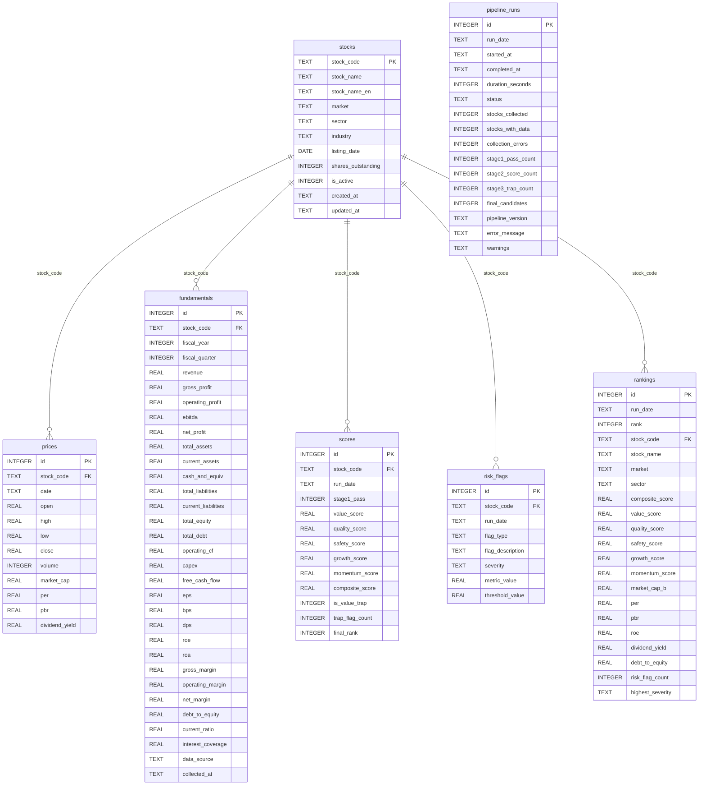

# ValueForge DB 명세서

> SQLite 스키마 v1.0 | 컬럼 상세 정의 및 ERD

---

## ERD

---

## 테이블 명세

### stocks — 종목 기준 정보

| 컬럼                 | 타입    | NULL    | 설명                                             |
| -------------------- | ------- | ------- | ------------------------------------------------ |
| `stock_code`         | TEXT    | NO (PK) | KRX 6자리 종목 코드 (예: `005930`)               |
| `stock_name`         | TEXT    | NO      | 한국어 종목명 (예: `삼성전자`)                   |
| `stock_name_en`      | TEXT    | YES     | 영문 종목명                                      |
| `market`             | TEXT    | NO      | 상장 시장 — `KOSPI` 또는 `KOSDAQ`                |
| `sector`             | TEXT    | YES     | KRX 섹터 분류 (예: `전기전자`)                   |
| `industry`           | TEXT    | YES     | KRX 업종 분류 (예: `반도체`)                     |
| `listing_date`       | DATE    | YES     | 상장일 (`YYYY-MM-DD`)                            |
| `shares_outstanding` | INTEGER | YES     | 상장 주식 수 (주)                                |
| `is_active`          | INTEGER | NO      | 거래 가능 여부 — `1` 활성, `0` 상장폐지·거래정지 |
| `created_at`         | TEXT    | YES     | 최초 등록 시각 (`datetime('now')`)               |
| `updated_at`         | TEXT    | YES     | 최종 갱신 시각 (`datetime('now')`)               |

**인덱스:** `idx_stocks_market` → `(market, is_active)`

---

### prices — 일별 주가 스냅샷

| 컬럼             | 타입    | NULL    | 단위     | 설명                           |
| ---------------- | ------- | ------- | -------- | ------------------------------ |
| `id`             | INTEGER | NO (PK) | —        | 자동 증가 PK                   |
| `stock_code`     | TEXT    | NO (FK) | —        | → stocks.stock_code            |
| `date`           | TEXT    | NO      | —        | 기준일 (`YYYY-MM-DD`)          |
| `open`           | REAL    | YES     | KRW      | 시가                           |
| `high`           | REAL    | YES     | KRW      | 고가                           |
| `low`            | REAL    | YES     | KRW      | 저가                           |
| `close`          | REAL    | NO      | KRW      | 종가                           |
| `volume`         | INTEGER | YES     | 주       | 거래량 (pykrx `거래량` 원시값) |
| `market_cap`     | REAL    | YES     | KRW 십억 | 시가총액                       |
| `per`            | REAL    | YES     | 배       | 주가수익비율                   |
| `pbr`            | REAL    | YES     | 배       | 주가순자산비율                 |
| `dividend_yield` | REAL    | YES     | %        | 배당수익률                     |

**유니크 제약:** `(stock_code, date)`  
**인덱스:** `idx_prices_code_date` → `(stock_code, date DESC)`  
**데이터 소스:** pykrx `get_market_ohlcv_by_ticker`, `get_market_cap_by_ticker`, `get_market_fundamental_by_ticker`

> `trading_value`(거래대금)는 수집 후 DB에 저장하지 않고 스크리닝 시 별도 집계(`fetch_avg_trading_value_20d`)로 사용한다.

---

### fundamentals — 재무제표 (연간·분기)

| 컬럼                  | 타입    | NULL    | 단위     | 설명                                  |
| --------------------- | ------- | ------- | -------- | ------------------------------------- |
| `id`                  | INTEGER | NO (PK) | —        | 자동 증가 PK                          |
| `stock_code`          | TEXT    | NO (FK) | —        | → stocks.stock_code                   |
| `fiscal_year`         | INTEGER | NO      | —        | 사업연도 (예: `2024`)                 |
| `fiscal_quarter`      | INTEGER | NO      | —        | 분기 — `0` = 연간, `1~4` = 분기       |
| **손익계산서**        |         |         |          |                                       |
| `revenue`             | REAL    | YES     | KRW 십억 | 매출액                                |
| `gross_profit`        | REAL    | YES     | KRW 십억 | 매출총이익                            |
| `operating_profit`    | REAL    | YES     | KRW 십억 | 영업이익                              |
| `ebitda`              | REAL    | YES     | KRW 십억 | EBITDA                                |
| `net_profit`          | REAL    | YES     | KRW 십억 | 당기순이익                            |
| **재무상태표**        |         |         |          |                                       |
| `total_assets`        | REAL    | YES     | KRW 십억 | 자산총계                              |
| `current_assets`      | REAL    | YES     | KRW 십억 | 유동자산                              |
| `cash_and_equiv`      | REAL    | YES     | KRW 십억 | 현금및현금성자산                      |
| `total_liabilities`   | REAL    | YES     | KRW 십억 | 부채총계                              |
| `current_liabilities` | REAL    | YES     | KRW 십억 | 유동부채                              |
| `total_equity`        | REAL    | YES     | KRW 십억 | 자본총계                              |
| `total_debt`          | REAL    | YES     | KRW 십억 | 이자부 부채 (차입금 합계)             |
| **현금흐름표**        |         |         |          |                                       |
| `operating_cf`        | REAL    | YES     | KRW 십억 | 영업활동 현금흐름                     |
| `capex`               | REAL    | YES     | KRW 십억 | 자본적 지출                           |
| `free_cash_flow`      | REAL    | YES     | KRW 십억 | 잉여현금흐름 (`operating_cf - capex`) |
| **주당 데이터**       |         |         |          |                                       |
| `eps`                 | REAL    | YES     | KRW      | 주당순이익                            |
| `bps`                 | REAL    | YES     | KRW      | 주당순자산                            |
| `dps`                 | REAL    | YES     | KRW      | 주당배당금                            |
| **파생 비율**         |         |         |          |                                       |
| `roe`                 | REAL    | YES     | %        | 자기자본이익률                        |
| `roa`                 | REAL    | YES     | %        | 총자산이익률                          |
| `gross_margin`        | REAL    | YES     | %        | 매출총이익률                          |
| `operating_margin`    | REAL    | YES     | %        | 영업이익률                            |
| `net_margin`          | REAL    | YES     | %        | 순이익률                              |
| `debt_to_equity`      | REAL    | YES     | 배       | 부채비율                              |
| `current_ratio`       | REAL    | YES     | 배       | 유동비율                              |
| `interest_coverage`   | REAL    | YES     | 배       | 이자보상배율                          |
| `data_source`         | TEXT    | YES     | —        | 데이터 출처 (기본값 `dart`)           |
| `collected_at`        | TEXT    | YES     | —        | 수집 시각                             |

**유니크 제약:** `(stock_code, fiscal_year, fiscal_quarter)`  
**인덱스:** `idx_fundamentals_code_year` → `(stock_code, fiscal_year DESC)`  
**데이터 소스:** DART OpenAPI

---

### scores — 스크리닝 점수

| 컬럼              | 타입    | NULL    | 설명                                        |
| ----------------- | ------- | ------- | ------------------------------------------- |
| `id`              | INTEGER | NO (PK) | 자동 증가 PK                                |
| `stock_code`      | TEXT    | NO (FK) | → stocks.stock_code                         |
| `run_date`        | TEXT    | NO      | 파이프라인 실행 기준일 (`YYYY-MM-DD`)       |
| `stage1_pass`     | INTEGER | NO      | Stage 1 통과 여부 — `1` 통과, `0` 탈락      |
| `value_score`     | REAL    | YES     | 가치 점수 (0–100, percentile rank)          |
| `quality_score`   | REAL    | YES     | 수익성·퀄리티 점수 (0–100)                  |
| `safety_score`    | REAL    | YES     | 안전성 점수 (0–100)                         |
| `growth_score`    | REAL    | YES     | 성장성 점수 (0–100)                         |
| `momentum_score`  | REAL    | YES     | 모멘텀 점수 (0–100)                         |
| `composite_score` | REAL    | YES     | 가중 합산 복합 점수 (0–100)                 |
| `is_value_trap`   | INTEGER | NO      | Stage 3 가치 함정 판정 — `1` 함정, `0` 정상 |
| `trap_flag_count` | INTEGER | YES     | 감지된 함정 플래그 총 개수                  |
| `final_rank`      | INTEGER | YES     | Stage 4 최종 순위 (함정 제외 시 NULL)       |

**유니크 제약:** `(stock_code, run_date)`  
**인덱스:** `idx_scores_run_date` → `(run_date, composite_score DESC)`

---

### risk_flags — 가치 함정 리스크 플래그

| 컬럼               | 타입    | NULL    | 설명                                            |
| ------------------ | ------- | ------- | ----------------------------------------------- |
| `id`               | INTEGER | NO (PK) | 자동 증가 PK                                    |
| `stock_code`       | TEXT    | NO (FK) | → stocks.stock_code                             |
| `run_date`         | TEXT    | NO      | 파이프라인 실행 기준일                          |
| `flag_type`        | TEXT    | NO      | 플래그 유형 (아래 목록 참조)                    |
| `flag_description` | TEXT    | YES     | 플래그 상세 설명                                |
| `severity`         | TEXT    | NO      | 심각도 — `LOW` / `MEDIUM` / `HIGH` / `CRITICAL` |
| `metric_value`     | REAL    | YES     | 실제 지표값                                     |
| `threshold_value`  | REAL    | YES     | 기준 임계값                                     |

**flag_type 목록:**

| flag_type               | 의미                   | 최대 심각도 |
| ----------------------- | ---------------------- | ----------- |
| `NEGATIVE_ROE`          | ROE 음수 (수익성 악화) | HIGH        |
| `EXCESSIVE_DEBT`        | 과도한 부채비율        | HIGH        |
| `PERSISTENT_LOSS`       | 지속적 순손실          | CRITICAL    |
| `REVENUE_DECLINE`       | 매출 감소 추세         | MEDIUM      |
| `NEGATIVE_FCF`          | 잉여현금흐름 음수      | MEDIUM      |
| `CASH_BURN`             | 현금 소진 위험         | HIGH        |
| `AUDIT_ISSUE`           | 감사 의견 비적정       | CRITICAL    |
| `EQUITY_EROSION`        | 자본 잠식              | CRITICAL    |
| `DECLINING_MARGINS`     | 이익률 지속 하락       | MEDIUM      |
| `LOW_INTEREST_COVERAGE` | 이자보상배율 위험 수준 | HIGH        |
| `HOLDING_COMPANY`       | 지주회사 구조          | LOW         |
| `HIGH_CAPEX`            | 과도한 자본 지출       | LOW         |

**인덱스:** `idx_risk_flags_code_date` → `(stock_code, run_date)`

> **자동 실격 규칙:** CRITICAL 플래그 1개 이상, 또는 HIGH 플래그 2개 이상 → `is_value_trap = 1`

---

### rankings — 최종 랭킹 (비정규화 캐시)

대시보드 조인 비용 제거를 위해 `scores` + `stocks` + `fundamentals` 핵심 컬럼을 사전 집계한 테이블.

| 컬럼               | 타입    | NULL    | 설명                                                  |
| ------------------ | ------- | ------- | ----------------------------------------------------- |
| `id`               | INTEGER | NO (PK) | 자동 증가 PK                                          |
| `run_date`         | TEXT    | NO      | 파이프라인 실행 기준일                                |
| `rank`             | INTEGER | NO      | 최종 순위                                             |
| `stock_code`       | TEXT    | NO (FK) | → stocks.stock_code                                   |
| `stock_name`       | TEXT    | NO      | 종목명 (비정규화)                                     |
| `market`           | TEXT    | NO      | 시장 구분 (비정규화)                                  |
| `sector`           | TEXT    | YES     | 섹터 (비정규화)                                       |
| `composite_score`  | REAL    | NO      | 복합 점수                                             |
| `value_score`      | REAL    | YES     | 가치 점수                                             |
| `quality_score`    | REAL    | YES     | 퀄리티 점수                                           |
| `safety_score`     | REAL    | YES     | 안전성 점수                                           |
| `growth_score`     | REAL    | YES     | 성장성 점수                                           |
| `momentum_score`   | REAL    | YES     | 모멘텀 점수                                           |
| `market_cap_b`     | REAL    | YES     | 시가총액 (KRW 십억)                                   |
| `per`              | REAL    | YES     | PER (배)                                              |
| `pbr`              | REAL    | YES     | PBR (배)                                              |
| `roe`              | REAL    | YES     | ROE (%)                                               |
| `dividend_yield`   | REAL    | YES     | 배당수익률 (%)                                        |
| `debt_to_equity`   | REAL    | YES     | 부채비율 (배)                                         |
| `risk_flag_count`  | INTEGER | YES     | 총 리스크 플래그 수                                   |
| `highest_severity` | TEXT    | YES     | 최고 심각도 플래그 (`LOW`/`MEDIUM`/`HIGH`/`CRITICAL`) |

**유니크 제약:** `(run_date, stock_code)`  
**인덱스:** `idx_rankings_run_date_rank`, `idx_rankings_market`, `idx_rankings_sector`

---

### pipeline_runs — 파이프라인 실행 이력

| 컬럼                 | 타입    | NULL        | 설명                                                     |
| -------------------- | ------- | ----------- | -------------------------------------------------------- |
| `id`                 | INTEGER | NO (PK)     | 자동 증가 PK                                             |
| `run_date`           | TEXT    | NO (UNIQUE) | 실행 기준일 (`YYYY-MM-DD`)                               |
| `started_at`         | TEXT    | YES         | 파이프라인 시작 시각                                     |
| `completed_at`       | TEXT    | YES         | 파이프라인 종료 시각                                     |
| `duration_seconds`   | INTEGER | YES         | 소요 시간 (초)                                           |
| `status`             | TEXT    | NO          | 실행 상태 — `RUNNING` / `SUCCESS` / `FAILED` / `PARTIAL` |
| `stocks_collected`   | INTEGER | YES         | 수집 시도 종목 수                                        |
| `stocks_with_data`   | INTEGER | YES         | 데이터 수집 성공 종목 수                                 |
| `collection_errors`  | INTEGER | YES         | 수집 실패 종목 수                                        |
| `stage1_pass_count`  | INTEGER | YES         | Stage 1 통과 종목 수                                     |
| `stage2_score_count` | INTEGER | YES         | Stage 2 점수 산출 종목 수                                |
| `stage3_trap_count`  | INTEGER | YES         | Stage 3 함정 감지 종목 수                                |
| `final_candidates`   | INTEGER | YES         | Stage 4 최종 후보 수                                     |
| `pipeline_version`   | TEXT    | YES         | 파이프라인 버전                                          |
| `error_message`      | TEXT    | YES         | 실패 시 오류 메시지                                      |
| `warnings`           | TEXT    | YES         | 경고 목록 (JSON 배열)                                    |

---

## 인덱스 요약

| 인덱스명                     | 테이블       | 컬럼                               | 용도                    |
| ---------------------------- | ------------ | ---------------------------------- | ----------------------- |
| `idx_prices_code_date`       | prices       | `(stock_code, date DESC)`          | 종목별 최신 주가 조회   |
| `idx_fundamentals_code_year` | fundamentals | `(stock_code, fiscal_year DESC)`   | 종목별 최신 재무 조회   |
| `idx_scores_run_date`        | scores       | `(run_date, composite_score DESC)` | 실행일별 점수 정렬      |
| `idx_rankings_run_date_rank` | rankings     | `(run_date DESC, rank ASC)`        | 대시보드 메인 랭킹      |
| `idx_rankings_market`        | rankings     | `(market, run_date DESC)`          | 시장별 필터링           |
| `idx_rankings_sector`        | rankings     | `(sector, run_date DESC)`          | 섹터별 필터링           |
| `idx_risk_flags_code_date`   | risk_flags   | `(stock_code, run_date)`           | 종목·날짜별 플래그 조회 |
| `idx_stocks_market`          | stocks       | `(market, is_active)`              | 활성 종목 필터링        |
